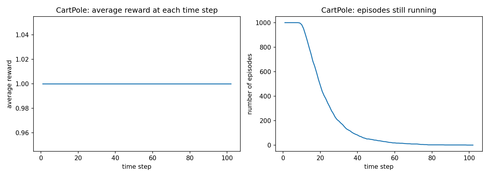
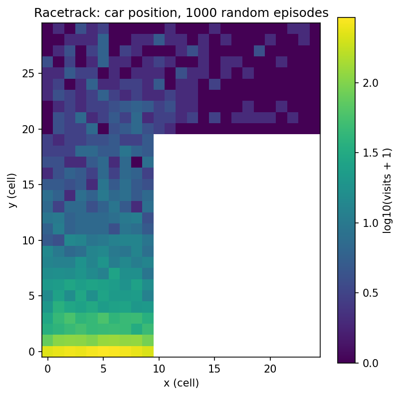
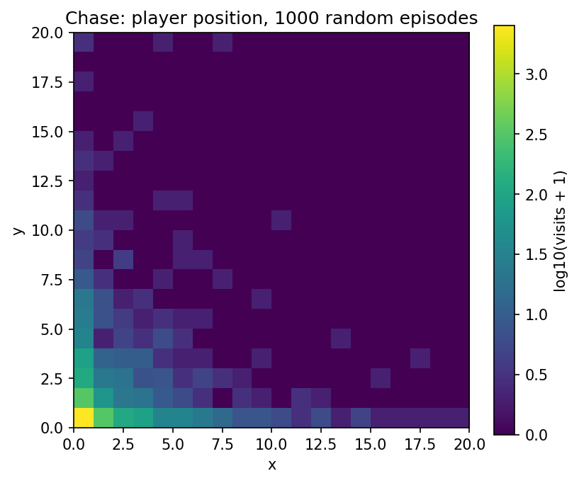

# Lab 2: Environmental Simulators

Oliver Grudzinski

I used CartPole-v1, where the agent pushes a cart left or right to keep a pole balanced on top of it.
The state is the cart's position and velocity plus the pole's angle and angular velocity. The agent
gets +1 per step, and the episode ends when the pole tips past about 12 degrees (0.21 rad), the cart
goes past ±2.4, or it hits 500 steps. I defined success as reaching 500 steps, meaning the pole never
fell.[1]

Over 1000 random episodes (23,546 states, Table 1) every variable averages about zero because random
pushes don't favor a side. The cart never got past 1.2 (the limit is 2.4), while the pole angle reached
±0.26 rad, past its 0.21 limit, so every episode ended because the pole fell.

**Table 1.** CartPole state over all 1000 random episodes.

| | Cart position | Cart velocity | Pole angle | Pole ang. velocity |
|---|---|---|---|---|
| Mean | -0.002 | -0.008 | 0.001 | 0.011 |
| SD | 0.093 | 0.542 | 0.101 | 0.826 |
| Min | -0.832 | -2.345 | -0.256 | -3.035 |
| Max | 1.201 | 2.485 | 0.262 | 3.163 |

Averaged over the episodes still running, the reward at each time step is exactly 1 (Figure 1, left),
since CartPole always pays +1 while alive. Averaged over all 1000 episodes, counting 0 after an episode
ends, the average reward at step t is just the fraction still running (Figure 1, right, divided by
1000): under half by step 20, under 10% by step 38, and 0 after step 102. The mean length was
22.5 steps and none reached 500, so the success rate was 0%.[1]

**Figure 1.** Average reward at each time step (left) and episodes still running (right).

My racetrack is a 25 by 30 grid: a vertical section 10 wide running all 30 rows, and the horizontal
section in the top 10 rows sticking out 15 cells to the right. The random car finished in 3 of 1000
episodes (0.3%).[2] Figure 2 shows it mostly stays near the start: 40% of positions are on the start
row and only 76 of 6,248 reach the horizontal section. Random velocity changes drift the car into a side
wall long before the turn (mean episode 6.2 steps).

For the chase I used n = 20 since the lab doesn't give it. The player never reached base and was caught
in all 1000 episodes, on average after 4.1 steps.[2] In Figure 3, 94% of positions are in the 5 by 5
corner by the start and none are near base. The predator moves 4 per turn while the player starts at
rest and gains at most 1.5 speed per step, so it gets caught before it gets going.

**Figure 2 (left) and Figure 3 (right).** Agent position over 1000 random episodes, log scale.

For both environments I used -1 per step, +100 for winning (finish line or base), and -100 for losing
(crash or caught). On the racetrack the step penalty rewards going fast, which is the point of the
task. In the chase it matters for a different reason: every extra step is another turn for the predator
to catch the player. In both, the ±100 makes winning vs losing matter more than time.[3]

The main challenge is that the +100 is sparse. Random exploration saw it 3 times on the racetrack and
never in the chase, so almost all early data ends in -100. On the racetrack that creates a bad local
optimum: among crashes, crashing sooner scores better (fewer -1 steps), so until the agent finds the
finish, the data says "crash fast." In the chase the reward says nothing about the predator until the
catch, so the agent has to figure out which earlier velocity changes caused it from one -100 at the end,
and the random velocities and predator start make returns noisy.[3] Writing a reward was easy, but
picking the numbers wasn't, since the step penalty compared to the terminal rewards changes what the
best policy is.

The state needs to be Markov, meaning the next state only depends on the current state and action. On
the racetrack, position alone fails that, because the same cell with different velocities leads to
different next cells, so the state is (x, y, vx, vy). Velocity also tells the agent if it can still
turn before a wall. The track is fixed, so it doesn't need to be in the state. That's 450 cells times
45 velocity combinations, about 20,000 states, so tabular methods could work.[4]

For the chase the state is player position, player velocity, and predator position (the base is
fixed). The predator always moves straight at the player, so it doesn't need its own velocity. The only
other randomness is the coin flip for who moves first and the random velocity change, and those are part
of the dynamics, so the state is still Markov. Everything is continuous, so the agent needs function
approximation or a binned field.[4]

I modified the racetrack so each reset puts 40 blocked cells at random on the track (about 9% of it,
never on the start row or finish column). Hitting one is a crash.

**Table 2.** Original vs modified racetrack, 1000 random episodes each.

| | Success rate | Avg episode reward | Avg episode length |
|---|---|---|---|
| Racetrack | 0.3% | -104.6 | 6.2 |
| Racetrack + obstacles | 0.0% | -103.7 | 4.7 |

With obstacles, success went from 0.3% to 0% and episodes got shorter, but average reward went up
slightly. That's misleading, since shorter episodes just collect fewer -1 penalties before the -100.
And 0.3% vs 0% is only 3 episodes.[5]

I think it would be much harder to learn, but mostly for reasons the table can't show, because a random
agent ignores the state. The obstacles move every episode, so if they aren't in the state, the same
(x, y, vx, vy) is safe one episode and a crash the next. From the agent's view the environment is
partially observable, and the transitions it sees come from a mix of layouts, so the best it can learn
is the average risk of each cell. If the obstacles are in the state, the state space blows up, since
every layout is a new track. Exploration also gets worse: random play almost never reached the finish
before, and with obstacles it never did, so the +100 is even rarer.[5]

The racetrack is a tiny driving simulator. A random policy crashed in about 6 steps, and you can't let
a real car learn that way, so simulators let the agent fail for free. The catch is that the agent learns
the simulator, so if the dynamics are wrong (I had to assume the track shape and velocity limits) the
policy won't transfer. The chase's random velocity is like actuator noise on a robot. For recommenders,
a simulator lets you test a policy before real users see it, but like lab 1, users are partially
observed and change over time, and the reward (clicks vs long-term satisfaction) shapes the policy the
same way the step penalty does here.[6]

---

[n] marks a sentence that answers question n.
