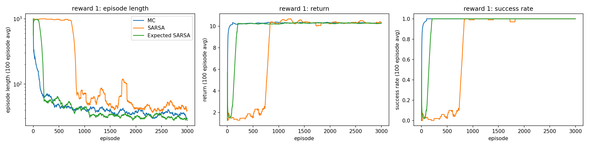
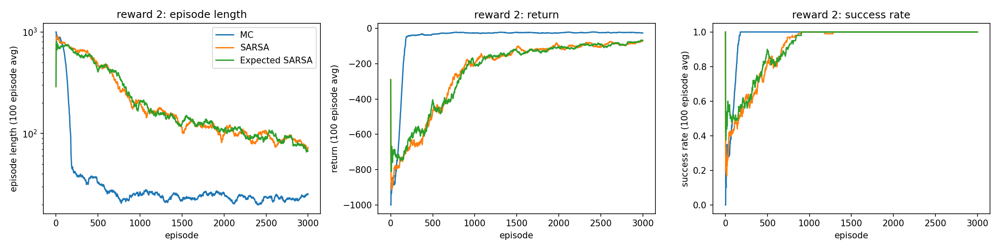
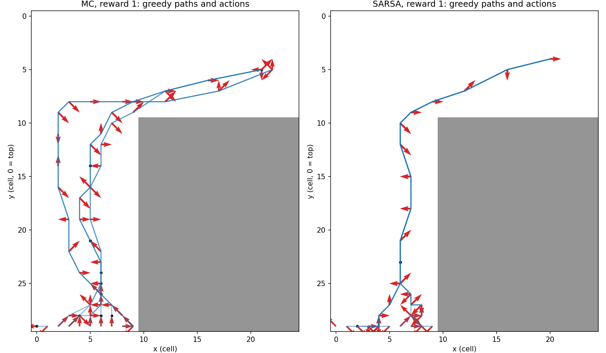
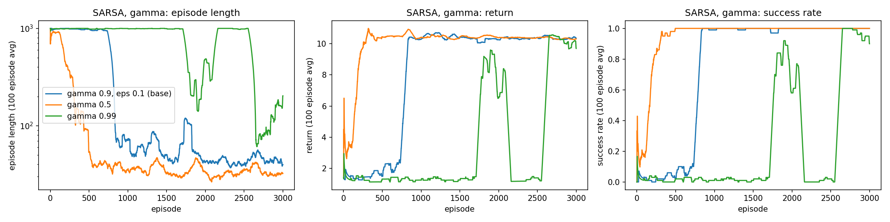
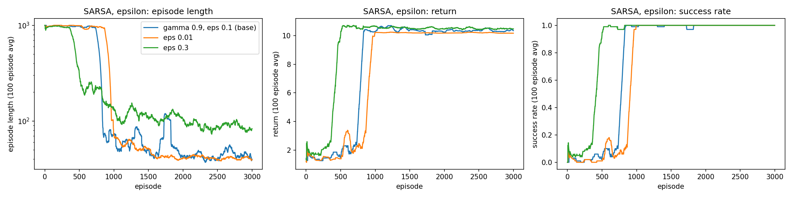
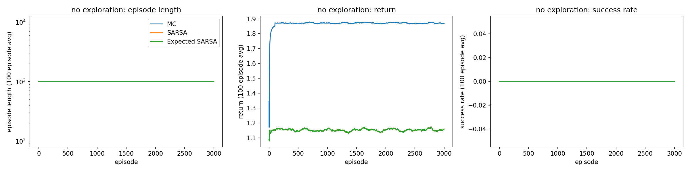
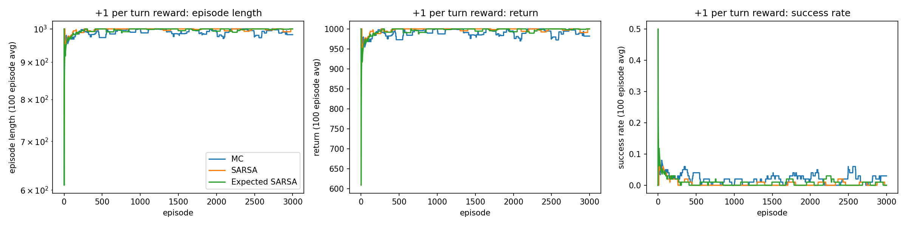
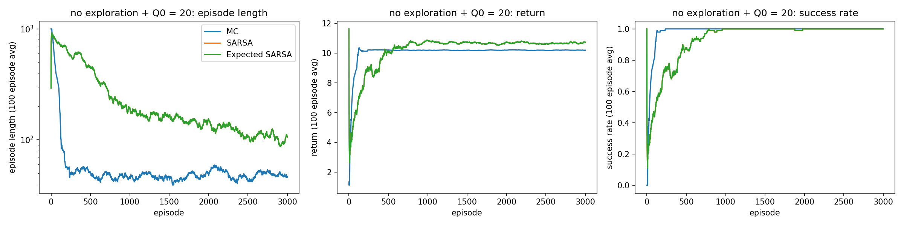

# Lab 3: Classical Reinforcement Learning

Oliver Grudzinski

I used the example `race_environment` class as-is, with a small subclass so a crash sends the car back to the
start line and the episode keeps going. The state is (x, y, vertical speed,
horizontal speed). Position alone isn't Markov because the same cell at different speeds leads to different
places, and the track never changes so it doesn't need to be in the state.[1] Reward 1 is the example reward:
1 / max(1, squared distance to the middle of the finish line) each turn, and 10 for crossing. Reward 2 is
mine: -1 every turn, so the return is minus the number of turns and the fastest race is the best one.[1]

With random actions the car took 3,463 turns on average to finish the modified track, but it always
finished. On the original track, where a crash ends the race, it finished 1 of 100 races.[2] The modification
helps since every episode eventually reaches the +10, so the finish actually shows up in the data. But reward
1 is always positive, so nothing punishes a long race, and a crash only costs the reward the car would have
gotten later. With γ = 0.9, sitting next to the finish forever is worth 1 / (1 - 0.9) = 10, the same as
crossing it.[2]

I trained each algorithm on both rewards for 3,000 episodes with ε = 0.1, γ = 0.9, α = 0.5, Q starting at 0,
and a 1,000-turn cap that counts as a fail.[3] Episodes start near the cap and drop to 25 to 70 turns (Table 1,
Figures 1 and 2). Training time follows episode length since every turn is one step and one update, so most of
the compute goes into the first few hundred episodes.[3]

**Table 1.** Training results. Greedy = 100 test races with ε = 0 after training.

| Algorithm | Reward | Total turns | Length, first 100 | Length, last 100 | Greedy length | Greedy success |
|---|---|---|---|---|---|---|
| MC | 1 | 133,503 | 156 | 30 | 17.1 | 100% |
| SARSA | 1 | 843,927 | 986 | 40 | 19.3 | 100% |
| Expected SARSA | 1 | 209,005 | 945 | 28 | 16.3 | 100% |
| MC | 2 | 137,588 | 624 | 25 | 12.9 | 100% |
| SARSA | 2 | 687,958 | 780 | 71 | 201 | 85% |
| Expected SARSA | 2 | 686,284 | 728 | 67 | 29.4 | 100% |

**Figure 1.** Reward 1, 100-episode moving averages.

**Figure 2.** Reward 2, 100-episode moving averages.

MC was the most sample efficient on both rewards, using the fewest total turns by far (Table 1).[3] One MC update pushes the final reward back to every state in the episode, while TD(0) only
moves it back one step per visit. On reward 1, SARSA was stuck near the cap for about 800 episodes because
any action it tried got a positive value and beat the untried 0s. On reward 2, Q = 0 is optimistic, so the TD
agents kept trying new actions and were still improving at 3,000 episodes.[3]

**Figure 3.** Greedy races from each start cell. Arrows show the velocity push, dots mean no change.

On reward 1, MC and SARSA both drive up the middle of the vertical section, push right around y = 10, and
cross at about y = 5, which is where reward 1 peaks. SARSA funnels every start cell into one line, while MC
uses two or three routes.[4]

All Q-values start at 0. With reward 1, the best start-line values ended at 0.75 (MC) and 0.50 (SARSA), which
fits a +10 discounted over a 20-ish turn race (10 × 0.9^20 ≈ 1.2). With reward 2, MC's start value is -8.6,
right in the range its 13 to 25 turn races give (-7.5 to -9.3). SARSA's is -5.8, which would mean an 8-turn
race, so it hasn't converged. Bootstrapping off neighbors that are still near 0 keeps it too optimistic.[5]

**Figures 4 and 5.** SARSA on reward 1 with different γ (top) and ε (bottom).

γ mattered more than ε. γ = 0.5 learned about twice as fast, since a short horizon mostly follows reward 1's
distance term, which already points at the finish. γ = 0.99 failed, and its greedy policy just parks on the
start line. Parking is worth about 0.09 vs about 8 for finishing, so that's a learning
problem, not what the reward wants. I think with a 100-turn horizon every target includes lots of crashes
back to the start, so the estimates stay noisy.[6] Higher ε found the finish sooner (episode 500 for ε = 0.3
vs 850 for 0.1) and gave the best greedy policy (15.4 turns), but its training episodes stayed twice as long
because 30% of its moves are random.[6]

To wreck learning I reran all three algorithms on two broken setups. Failure 1 was ε = 0 with reward 1. Since
the rewards are positive and Q starts at 0, the first action tried in a state stays greedy forever, and since
the agent's policy decides what data it collects, it never sees anything else. All three got 0% success, and
the MC agent just drove into the same wall over and over (107 crashes in 1,000 turns).[7] Failure 2 was +1
every turn. Longer races are worth more now, so the best policy never finishes, and success dropped to 0 to
3%.[7]

**Figures 6 and 7.** Failure 1 (ε = 0) and failure 2 (+1 per turn).

I fixed failure 1 without turning ε back on by starting every Q at 20, which is above anything reward 1
pays. Untried actions now look better than tried ones, so a greedy agent still tries everything before
settling. All three got back to 100% success (Figure 8), MC in about 150
episodes and the SARSAs in about 900 (with ε = 0 they're the same update). MC was the most robust overall. It
recovered fastest, was the most sample efficient in normal training, and never got stuck like SARSA did.[7]

**Figure 8.** Repair of failure 1: ε = 0 with Q starting at 20.

---

[n] marks a sentence that answers question n.
