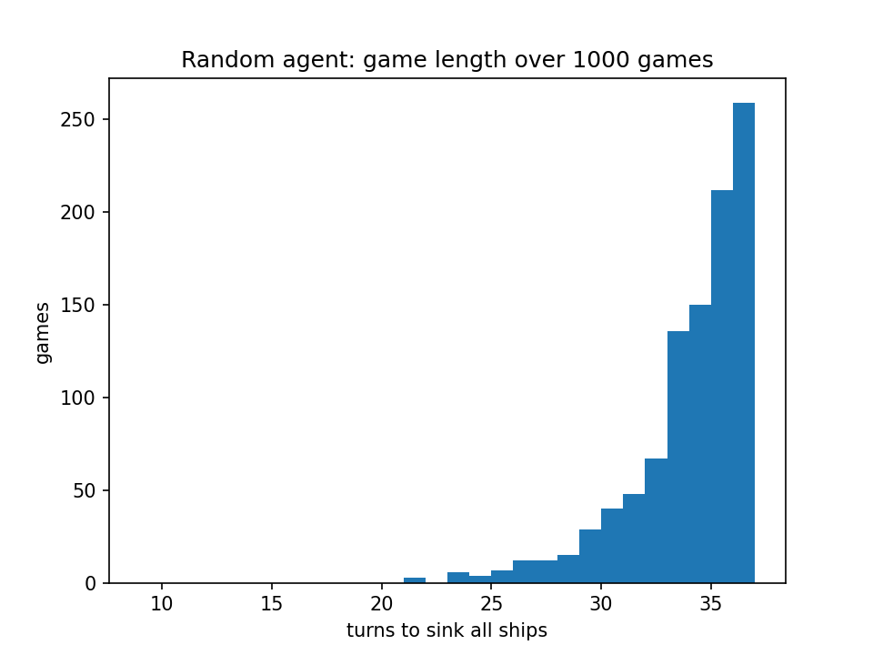
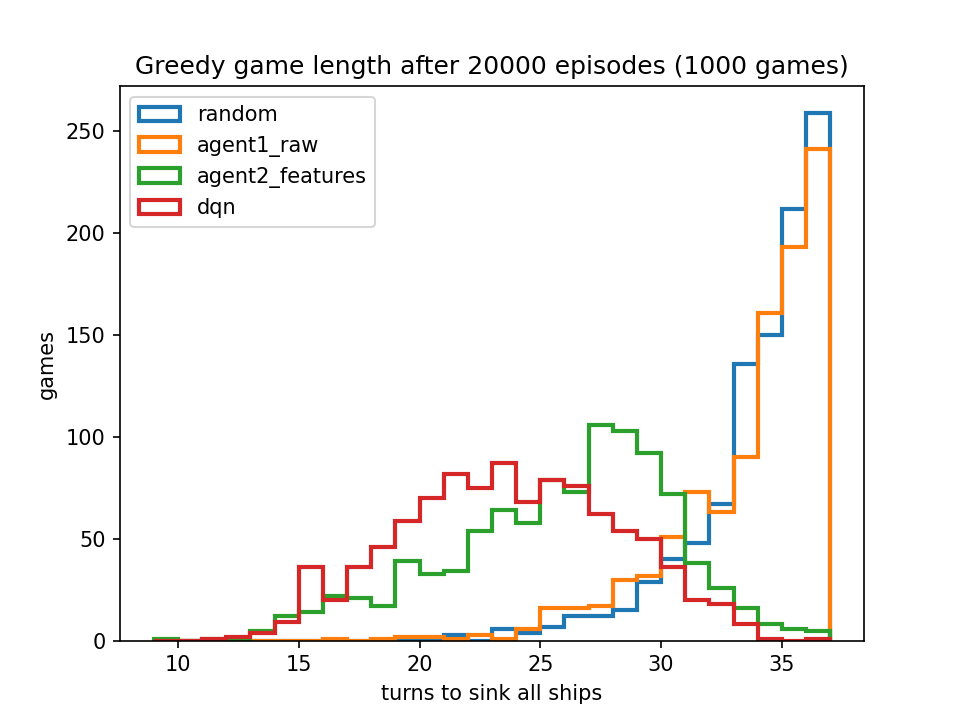
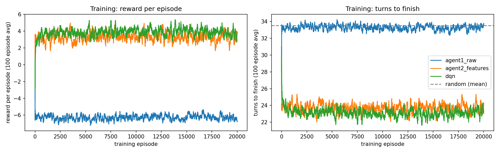
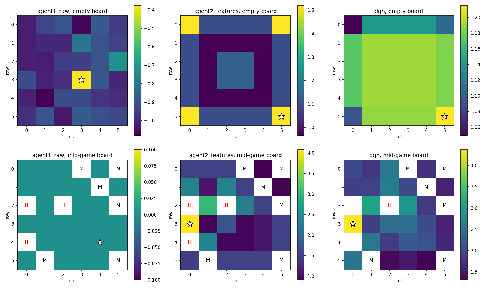
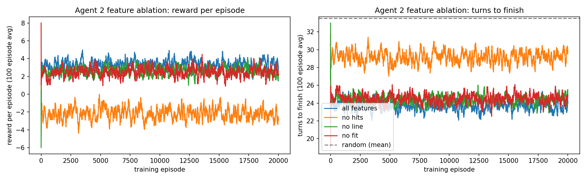
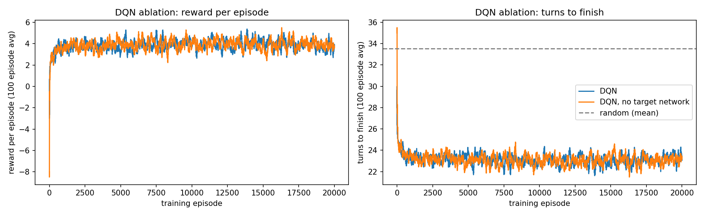

# Lab 4: Representation Learning via Modern RL

Oliver Grudzinski

*[n] marks a sentence that answers question n.*

The `Battleship` class keeps two 6 × 6 boards: `true_state`, the hidden fleet (1 = ship), and `state`, what
the agent sees (1 = hit, -1 = miss, 0 = not shot). `position_maker` picks a ship's first cell so the ship fits
on the board, `check_empty` checks that it wouldn't overlap another ship, and `place_ship` resamples the
position and a 50/50 orientation until it fits. `make_board` places all three ships, and `reset` clears both
boards and makes a new fleet. `step` marks the chosen cell as a hit or miss and calls `check_win`, which ends the
game at 2 + 3 + 4 = 9 hits. The win pays 10, and every other shot gets `reward()`, a TODO I filled in. The game
never says when a ship sinks, and it lets you shoot a cell twice.[1] I only changed `reward()`. Every agent,
random included, only picks untargeted cells, so a game lasts at most 36 turns.

{width=49%} {width=49%}

**Figure 1 (left) and Figure 2 (right).** Game length over 1,000 random games, and over 1,000 greedy games per
trained agent.

Random games took 33.5 turns on average (median 34), and 26% went all 36 turns (Figure 1). That fits the math.
The game ends on the last of the 9 ship cells, and in a random order the last of 9 cells out of 36 comes at shot
9 × 37 / 10 = 33.3 on average, and is the 36th shot with probability 9/36 = 25%. A random shooter has to clear
almost the whole board.[2]

The fleet is hidden, so this is a POMDP. The board records every shot and its result, so it's a sufficient
statistic for what the agent can know about the fleet, which makes it a Markov state.[3] Agent 1 uses the raw
board. That's up to 3^36^ ≈ 1.5 × 10^17^ states, and it saw 600,122 different ones in 20,000 games. Almost every
board it visited was new, with all Q-values still at 0, so its greedy policy is random tie-breaking.[3] For
agent 2, I describe the cell being shot instead of the whole board, so the action is "shoot a cell of this
type" and the agent shoots whichever untargeted cell has the best type. Each cell has three features: `hits`
(hit neighbors: 0, 1 or 2+), `line` (whether it continues two hits in a row), and `fit` (how many placements of
a 2, 3 or 4 ship cover it without covering a miss, as min(count // 4, 4)). That's 3 × 2 × 5 = 30 states, and it
visited 25 of them.[3]

The reward is +1 for a new hit and -1 for a miss, plus the 10 for the winning hit. A game of T turns returns
exactly 8 + 10 - (T - 9) = 27 - T, so more reward only comes from finishing sooner. Just counting hits would be
the "be careful" case, since re-shooting a hit cell would keep paying.[4] The dense ±1 tells the agent after
every shot whether that kind of cell was a good choice, which I think is why the agents learned within 100
games. With γ = 0.9, a +10 twenty turns away is worth 10 × 0.9^20^ ≈ 1.2, so the agents mostly go for hits soon,
which in Battleship is nearly the same thing as finishing fast.[4] DQN uses the same reward, so the only
difference between the agents is the representation.[4]

Each agent trained for 20,000 episodes with one seed. The tabular agents used ε = 0.1, γ = 0.9, α = 0.1, and DQN
used the starter config (ε = 0.1, γ = 0.9, Adam α = 0.001, B = 32, M = 100,000, an update every 4 turns, C = 500).

**Table 1.** Average turns per game. Checkpoints use 500 greedy (ε = 0) games. "Training" is the last 1,000
training games (ε = 0.1). Random is 33.5.

| Agent | 500 | 5,000 | 10,000 | 20,000 | Training |
|---|---|---|---|---|---|
| Agent 1, raw board | 33.1 | 33.0 | 33.2 | 33.1 | 33.4 |
| Agent 2, all features | 23.1 | 23.4 | 23.0 | 24.9 | 23.7 |
| Agent 2, no `hits` | 29.1 | 27.0 | 33.2 | 31.2 | 29.5 |
| Agent 2, no `line` | 23.1 | 24.5 | 24.3 | 23.6 | 24.7 |
| Agent 2, no `fit` | 23.7 | 24.0 | 23.9 | 25.2 | 24.5 |
| DQN | 23.9 | 22.9 | 23.2 | 23.5 | 23.3 |
| DQN, no target network | 22.6 | 22.6 | 23.0 | 22.4 | 23.2 |

**Figure 3.** Training reward and turns, 100-episode moving averages.

{width=82%}

**Figure 4.** Q-value of each cell on an empty board (top) and a mid-game board (bottom). H = hit, M = miss.
The star is the greedy pick.

On the mid-game board, agent 2 and DQN both pick (3, 0), between the two hits in column 0, and agent 1's
values are all 0 (Figure 4).[5] They differ in how they hunt. DQN's empty-board values are nearly flat (1.05 to
1.21), but agent 2 opens in a corner, because among cells with no hit next to them `fit` = 1 has Q = 1.52 and
`fit` = 4 (the open middle) has 1.14. That's backwards. I think low-`fit` cells mostly come up late in a game,
when the +10 is closer, and since agent 2's state isn't Markov, one Q-value averages over the whole game.[5]
That would also explain why its greedy games (25.3 turns) are worse than its ε = 0.1 training games (23.7),
since random shots break up the bad hunting order. So both learned to hunt and then finish off a ship, they
differ in the hunting, and agent 1 learned nothing (Figure 2).[5]

I didn't sweep γ or ε.[6] γ sets how much of the target comes from Q(s′) instead of the immediate ±1. Lower γ
means going for the most likely hit right now, which is already close to optimal, so I'd expect little change.
Higher γ leans on Q(s′), which for agent 2 is the part blurred by averaging, so I'd expect it to do worse. ε
controls the data the agent collects. Each of agent 2's Q-values is an average over whichever boards the behavior
policy reaches, so ε changes what it learns, not just how many shots it wastes. For DQN, ε decides what ends up
in the replay buffer.[6] I'd test this by changing one at a time (γ in {0.5, 0.9, 0.99}, ε in {0.01, 0.1, 0.3})
and comparing greedy turns at the same checkpoints.[6]

Agent 2 and DQN both beat random by 8 to 10 turns, and agent 1 didn't beat it at all (Table 1).[7] Agent 2 learned
fastest. It averaged 23.7 turns in its first 100 games and its last 1,000, since 30 table entries each get
thousands of updates in 100 games. DQN went from 24.2 over its first 500 games to 23.1 after episode 1,000, and it
won the final greedy games 23.2 to 25.3. So the order flips later, but they were tied at 10,000 episodes (23.0 vs
23.2). Agent 2's top three Q-values are within 0.05 of each other, so with α = 0.1 the update noise keeps
reordering them.[7]

{width=85%}

{width=85%}

**Figures 5 and 6.** Agent 2 with one feature removed (top), and DQN with and without a target network (bottom).

`hits` is the feature that matters. Without it, agent 2 is close to random (29.5 turns in training).[8] Cell types
with no hit next to them have Q between 0.9 and 1.5, and the 19 highest types all have one, so `hits` is what
switches the agent from hunting to finishing off a ship. Dropping `line` or `fit` costs about a turn. `line` only
helps once a ship has two hits, and `fit` was supposed to help with hunting but its values are backwards.[8] No
ablation changed sample efficiency, since every version flattened out within 100 games (Figure 5). Removing
DQN's target network didn't hurt either (22.4 vs 23.5 greedy, Figure 6).[8] A target network keeps the
bootstrap target from moving with each update. But games here are at most 36 turns, γ = 0.9 shrinks the Q(s′)
term, and most of each target is the immediate ±1, so errors in Q(s′) don't build up. I'd expect it to matter
with γ near 1 or longer games.[8] Overall, good features got most of what DQN did on a 6 × 6 board (8.2 of its
10.3 turns saved). DQN's edge is that I didn't have to design anything, and its state is Markov.

For question 9, I asked a separate Claude agent, which hadn't seen my analysis, why DQN outperformed agent 2
(prompt and answer in the appendix).[9] Its main claim was that most of the 2-turn final gap isn't a better
representation, since agent 2 tied or beat DQN at the first three checkpoints and then its greedy play fell below
its ε = 0.1 play. That's right, and its numbers check out. It also pointed out something I'd missed, which I
added to question 6: an aliased Q-value is weighted by how often the behavior policy reaches each board.[9] It
left out that agent 2's error isn't just random reordering, since `fit` is backwards in one consistent direction
(the corner opener in Figure 4). Its claim that the CNN wins by telling apart two hits capped by misses from two
open ones is unsupported, since nothing I ran looks at what the CNN represents.[9] What does support a small real
DQN edge is the training curves (23.1 vs 23.7 turns after episode 1,000) and fewer long games (8.4% vs 17.1% took
30 or more turns). With one seed, I can't tell if that half turn would hold up.[9]
