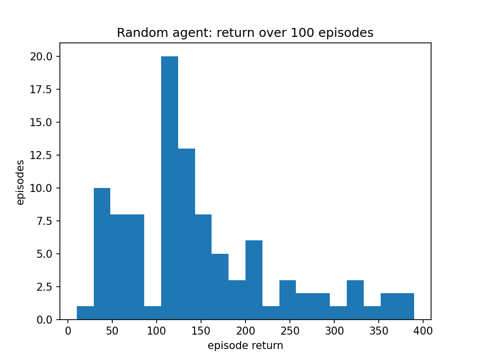
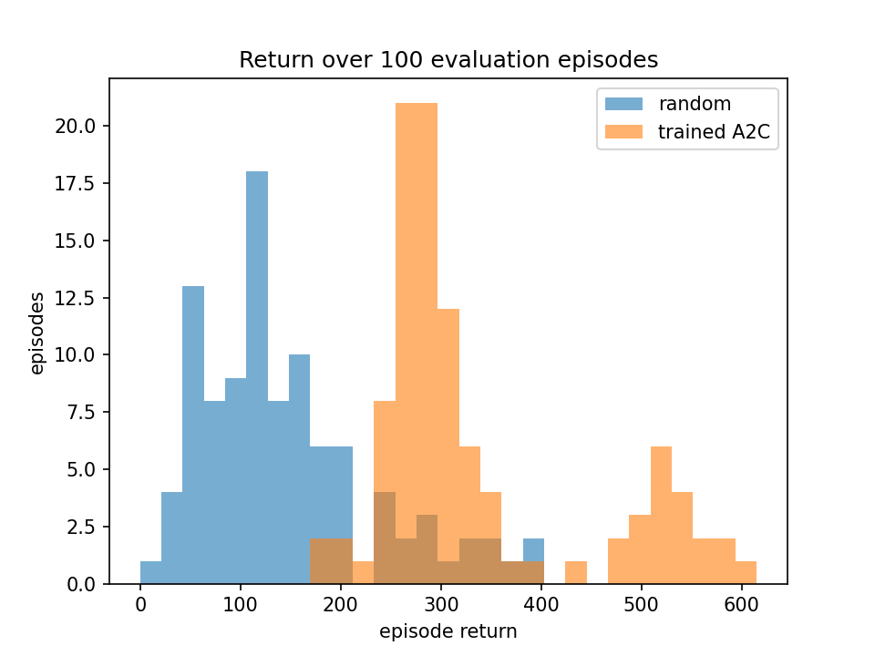
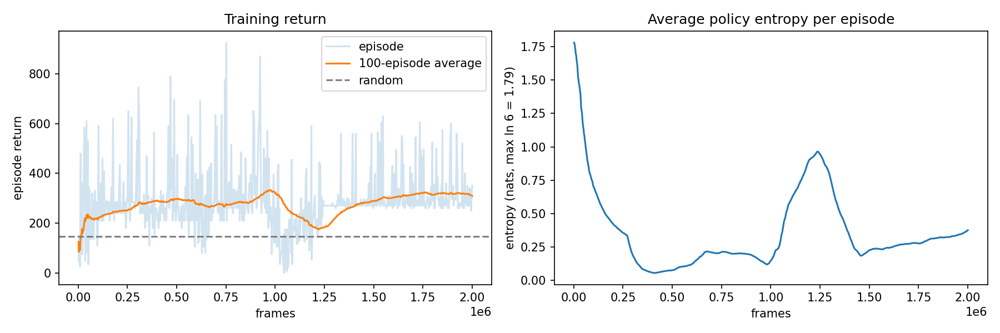
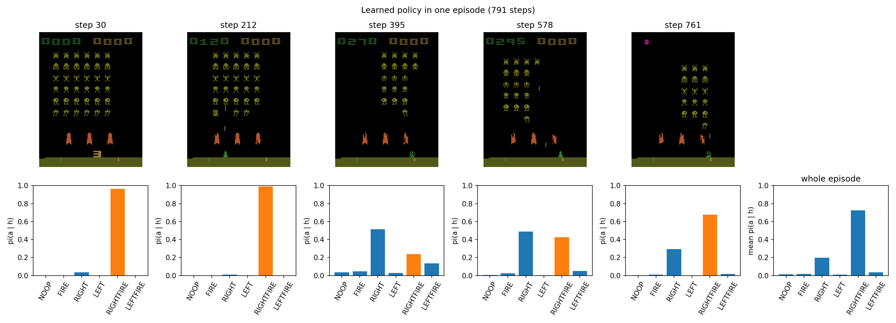
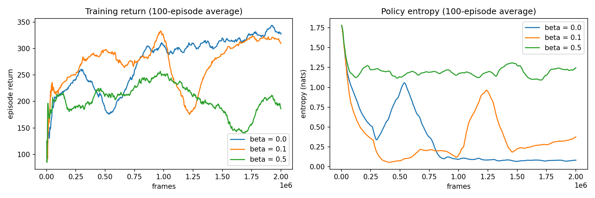
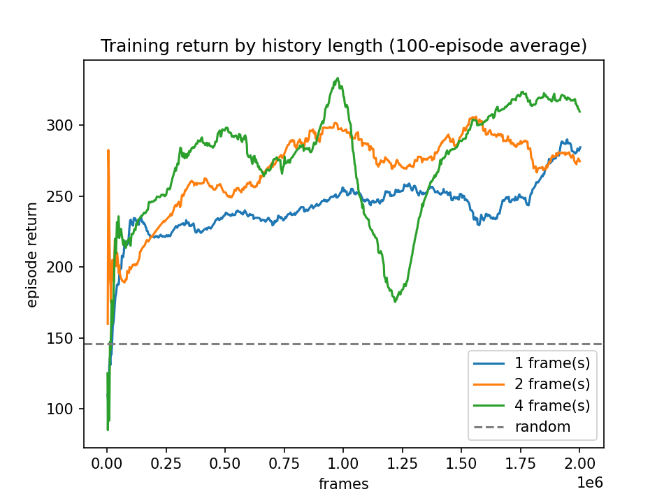

# Lab 5: Policy-Based RL with A2C on Space Invaders

Oliver Grudzinski

*[n] marks a sentence that answers question n.*

Space Invaders gives a 210 × 160 × 3 RGB frame every step and takes one of 6 actions: NOOP, FIRE, RIGHT, LEFT,
RIGHTFIRE and LEFTFIRE.[1] The reward is the points scored that step, 5 to 30 per alien depending on its row plus a
bonus for the mothership, and the player gets 3 lives.[1] With `terminal_on_life_loss=False` an episode is a whole
game, and `info` reports the lives left and the frame number.[1] v5 also uses sticky actions, so 25% of the time the
last action repeats instead of the chosen one, which makes the game random even for a fixed policy.

{width=49%} {width=49%}

**Figure 1.** Return over 100 random episodes (left), and random vs the trained agent over 100 evaluation episodes
(right).

The 100 random episodes averaged 145.8 points (variance 7,659, median 125) and lasted 504 steps, about 2,000 frames.[2]
The distribution is skewed right, with 28% of games at 100 or less and 8% at 300 or more (Figure 1).[2] Random play is
far from zero because the aliens fill a big part of the screen and half of the actions fire, so unaimed shots still
hit things. That means "just shoot a lot" is already worth points before any learning happens.[2]

`make_env` builds the game with `frameskip=1` and wraps it in `AtariPreprocessing`. On reset the wrapper does up to 30
random no-ops so games don't all start the same. Each agent step repeats the action for 4 frames and sums the reward,
and the observation is the max of the last two frames, since Atari sprites flicker. That gets converted to grayscale,
resized to 84 × 84, and scaled to [0, 1].[3] The agent then keeps a history of the last n screens. `init_history`
fills it with n copies of the first screen, `update_history` adds the newest screen and drops the oldest, and
`reshape_history` stacks them into an n × 84 × 84 array that the CNN reads as n input channels.[3] One screen only
shows positions, so the agent can't tell which way the formation is moving or whether a bullet is going up or down.
The right action depends on that, so a single frame only partially observes the state, and stacking 4 gets it close
to Markov.[3] Preprocessing also changes the problem itself. Each frame is 7,056 numbers instead of 100,800, the agent
makes about 600 decisions per game instead of 2,400, and γ = 0.99 now looks about 100 decisions (400 frames) ahead.[3]

The network is the starter's `CNNActorCritic`: three conv layers (32 8×8 filters with stride 4, 64 4×4 with stride 2,
64 3×3 with stride 1), each with LayerNorm and ReLU, then a 512-unit layer feeding two heads.[4] The actor head outputs
π(a|h) through a softmax over 6 logits, and the critic head outputs one number, V(h).[4] They're separate heads
because they learn different things in different ways. The actor is a probability distribution trained by the policy
gradient, and the critic is a regression onto the return G_t. The critic is there to make the actor's update less
noisy, since the advantage G_t - V(h_t) says whether an action did better or worse than usual from that state, and
subtracting a baseline that doesn't depend on the action lowers the variance without biasing the gradient.[4] After
each episode the loss is -[mean(A_t log π(a_t|h_t)) + β mean(H(π(h_t)))] + mean((G_t - V(h_t))²) with A_t detached,
so one backward pass and one Adam step update both heads and the shared layers.[4] Sharing the conv layers makes sense
because both heads need the same features (where the cannon, aliens and bullets are), it halves the parameters
compared to two networks, and the critic's regression loss keeps training those features even when the policy
gradient is noisy.[4]

**Table 1.** Tuning runs, 500k frames each with β = 0.1. Return and entropy are over the last 100 episodes.

| α | γ | Return | Entropy |
|---|---|---|---|
| 1e-4 | 0.9 | 171.0 | 1.68 |
| 1e-4 | 0.99 | 225.1 | 0.97 |
| 3e-4 | 0.9 | 172.6 | 1.62 |
| 3e-4 | 0.99 | **298.2** | 0.08 |

I tuned α and γ on short runs and kept the best (Table 1). β came from three 1M-frame pilots: at β = 0.5 the policy
stayed close to uniform, and at β = 0 it collapsed, so I went with 0.1. At the same β, γ = 0.9 kept the policy nearly
uniform and γ = 0.99 didn't. A shorter horizon makes G_t and the advantages smaller, so a fixed entropy bonus counts
for more. How strong β is depends on the reward scale and γ, not just its value.

{width=70%}

**Figure 2.** Training return and policy entropy for the main agent (α = 3e-4, γ = 0.99, β = 0.1, 4 frames).

The main agent trained for 2M frames (764 episodes). Over 100 evaluation episodes with no updates it averaged 334.9 with
a variance of 11,356 (std 106.6), compared to 145.8 and 7,659 for random.[5] Its worst game scored 170, which is above
the random median.[5] The variance is bigger in raw points but the spread relative to the mean is about half (std/mean
0.32 vs 0.60). The returns are bimodal, with 72 games between 230 and 360 and 20 games at 450 or more (Figure 1).[5]
The standard error of the mean is about 11, so the gain over random is clear, though this is one training seed.[5]
During training the return passed 250 within 250k frames, dropped to 184 around 1.2M frames while the entropy jumped
from 0.12 to 0.95, then recovered to 310 over the last 100 episodes (Figure 2).

**Figure 3.** The screen and π(a|h) at five points in one episode. Orange is the sampled action.

The agent heads right at the start and stays on the right side shooting (Figure 3). Over this episode, 92% of its
actions moved right and 78% fired.[6] It isn't totally ignoring the state, though. Early on it puts 0.96 to 0.99 on
RIGHTFIRE, but later in the wave it splits about evenly between RIGHT and RIGHTFIRE, and P(fire) gets as low as 0.30.[6]
A classmate asked me if my agent just learned to fire a bunch no matter the state, and mostly it did. A random shot
sometimes hits an alien, so spamming fire slowly racks up points. At one point their agent went into the corner and
hid, shooting the whole time and capping out at 105 to 115 points, and I told them to tune the entropy weight.[6] Mine
does a version of the same thing, but it still changes what it does with the state and scores 335. Getting stuck in a
corner like that is a data problem. A2C is on-policy, so the agent's own policy generates its data, and once π puts
nearly all its probability on one action, the episodes stop containing the other actions. The advantages for moving
somewhere better then never get estimated, so the policy has no reason to change. That's what β is for.[7]

**Figure 4.** Training return and policy entropy for β = 0, 0.1 and 0.5. Everything else matches the main agent.

**Table 2.** Both experiments, 2M training frames each and 100 evaluation episodes with no updates. The main agent is
β = 0.1 with 4 frames.

| Run | Eval mean | Eval variance | Final entropy |
|---|---|---|---|
| β = 0 | 319.3 | 16,866 | 0.08 |
| β = 0.1 (main) | **334.9** | 11,356 | 0.38 |
| β = 0.5 | 162.3 | 14,046 | 1.25 |
| 1 frame | 229.0 | 9,641 | 0.24 |
| 2 frames | 278.0 | 8,430 | 0.13 |

Entropy regularization adds βH(π) to the objective so the policy doesn't collapse onto one action before it has the
data to know that action is best.[7] In the update it adds β∇H, and for a softmax the gradient of H with respect to
logit a is -π(a)(ln π(a) + H), which pushes down actions that are more likely than average and pushes up the rest.[7]
It also moves the optimum. With the bonus, the best policy isn't deterministic anymore, so a big β makes the final
policy worse on purpose.[7] ε-greedy explores differently. It takes a uniform random action with probability ε, the
same in every state and set by a schedule, regardless of what the agent has learned. The entropy bonus is part of the
objective and trades off against the advantage in each state, so the policy gets sharp where one action is clearly
better and stays spread where actions look alike.[7] In my experiment (Figure 4, Table 2), β = 0.5 kept the entropy
above 1.09 the whole time. Since that exploration is also how it plays, it never used what it learned, and it scored
162.3, about random.[7] β = 0 and β = 0.1 both collapsed to a nearly deterministic policy at some point (β = 0.1
actually got there first, at 0.06 around 0.4M frames). β = 0 stayed collapsed and ended at 0.08 with the widest
evaluation spread (variance 16,866), while β = 0.1 drifted back up to 0.38.[7] So at this reward scale β = 0.1 doesn't
stop the collapse, it only pulls the policy back out of it later. It had the best mean and lowest variance, but it beat
β = 0 by only 15 points with standard errors of 11 and 13, so with one seed I can't call it better. The clear result
is that too much entropy hurts final policy quality.[7] The entropy spikes in the β = 0 run (1.05 at 0.53M
frames) and the main run (0.95 at 1.2M) both line up with return drops. β = 0 has no bonus, so those spikes come from
the policy gradient reshuffling the policy, not from β.

{width=62%}

**Figure 5.** Training return with 1, 2 and 4 stacked frames.

More frames did better at evaluation: 229.0 with 1 frame, 278.0 with 2 and 334.9 with 4 (Table 2), and each step is
about 50 points, or 4 to 5 standard errors.[8] With 1 frame the agent only sees positions, and its training curve sat
around 250 for most of the run (Figure 5).[8] 2 frames already show motion, so I expected them to get most of the
gain, but 4 still did 57 points better. The training averages over the last 100 episodes are closer (284, 275 and 310),
so the order is clear at evaluation but noisier in training.[8] The extra frames only add input channels to the first
conv layer, so the network is basically the same size, and the difference comes from the information in the state.[8]
